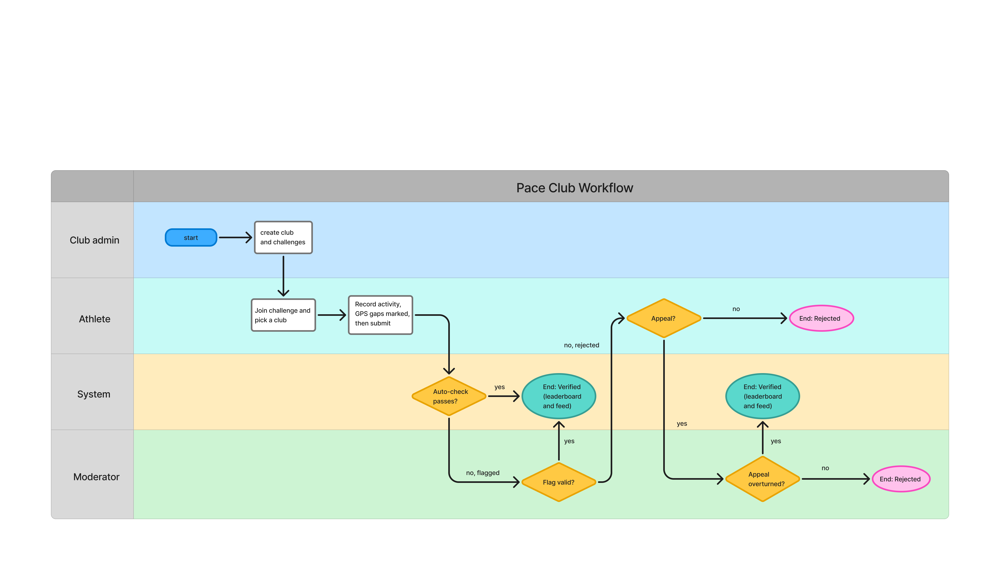

# Workflow: Pace Club

**Team:** 3A-MotionX Pace Club
**Owner and partner:** (fill in names)

**Core process:** Record, submit, verify or flag, appeal.

## Flow diagram

## In words

1. The club admin creates a club and challenges.
2. The athlete joins a challenge and picks a club.
3. The athlete records an activity. GPS gaps are marked while recording. Then the athlete submits it.
4. The system runs an auto-check. If it passes, the activity is **Verified** and counts on the leaderboard and feed.
5. If it does not pass, it is **Flagged** and a moderator reviews it.
6. If the moderator says the flag is valid, the activity is **Verified**. If not, it is **Rejected**.
7. The athlete can appeal a rejection once. The moderator then overturns it (**Verified**) or upholds it (stays **Rejected**). If the athlete does not appeal, it stays **Rejected**.

## Exception path

**Flag, reject, and appeal.** A flagged activity gets a second look from a moderator, and a rejected activity can be appealed once. Weak GPS signal is handled while recording: the gaps are marked and the auto-check takes them into account.

## States of an Activity

1. **Recording** (it can be **Paused** and resumed)
2. **Completed**: the athlete finished, not yet submitted
3. **Submitted**: waiting for the auto-check
4. **Flagged**: the auto-check found a problem, waiting for the moderator
5. **Verified**: counts on the leaderboard and feed
6. **Rejected**: the moderator said invalid (it can be appealed once)

A Rejected activity becomes Verified if the appeal is overturned.

## What and why

Pace Club is an activity tracker with clubs and challenges, similar to Strava. Athletes record a run, ride, or walk, submit it with a photo, and compete on a leaderboard. GPS data can be wrong or faked, so the app flags suspicious activities and lets athletes appeal to a moderator. Recording is mobile only, and the web shows history, clubs, and GPX import, which keeps the scope small enough for one term.